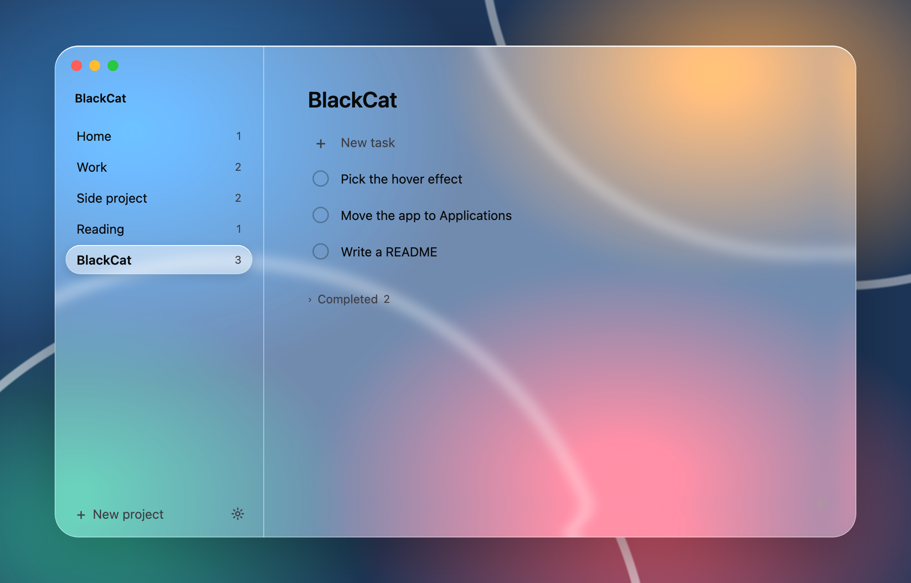
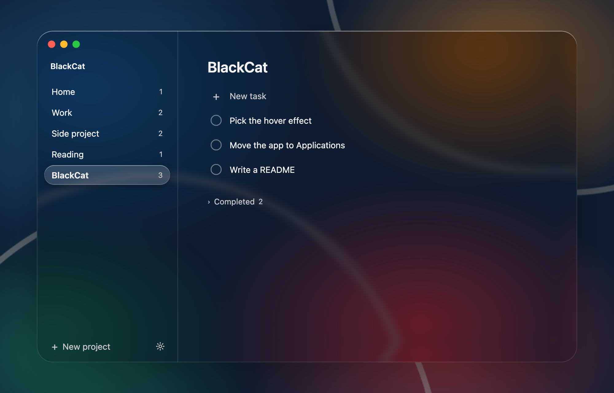
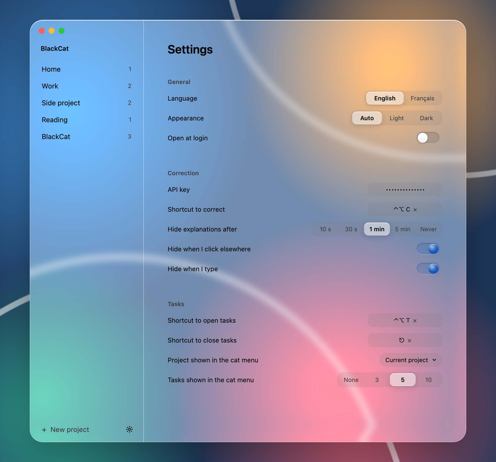

# BlackCat

A little black cat that lives in your Mac's menu bar.

- Select some text, press a shortcut, and it gets corrected in place.
  Hover a corrected word to see why it changed.
- A simple to-do list, sorted by project.

I made this for myself, for fun. If you found it and like it, enjoy.

## Download
Get BlackCat.zip from Releases, unzip it, and move BlackCat to Applications.
The app isn't notarized by Apple, so macOS will block it the first time:
open System Settings > Privacy & Security and click "Open Anyway".

## You'll need
- macOS 26 or later
- Your own OpenAI API key, pasted in the settings

## License
Free to use and share, non-commercial only. Please don't sell it. See LICENSE.
